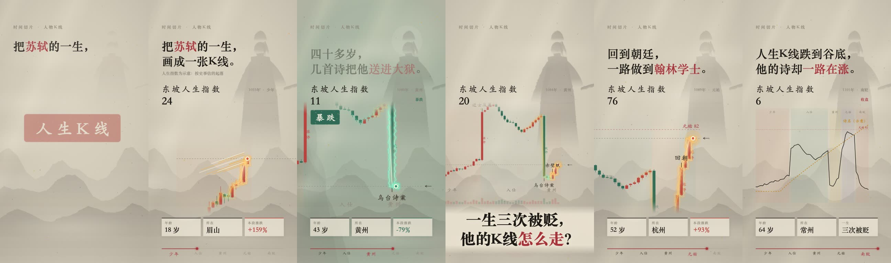

<h1 align="center">Life K-line · 人生K线</h1>

<p align="center">
  
</p>

<p align="center"><strong>Draw a whole life as a stock chart.</strong></p>
<p align="center">A Remotion template for 9:16 short videos: an ink-wash, old-paper world with a K-line that keeps growing to the right. Spikes and crashes land on the beat of the music. Includes an Agent skill to make a new episode for any person.</p>

<p align="center">
  <a href="./LICENSE"></a>
  <a href="https://github.com/Azure12355/life-kline/stargazers"></a>
  <a href="https://github.com/Azure12355/life-kline/commits"></a>
</p>

<p align="center">
  <strong>English</strong> · <a href="./README.zh-CN.md">简体中文</a>
</p>

<p align="center">
  
</p>

## Contents

- [Overview](#overview)
- [Features](#features)
- [Quick Start](#quick-start)
- [Make Your Own Episode](#make-your-own-episode)
- [Agent Skill](#agent-skill)
- [Project Map](#project-map)
- [Agent Quickstart](#agent-quickstart)
- [License](#license)

## Overview

The sample video draws the life of the Song-dynasty poet Su Shi (苏轼, 1037–1101) as a stock chart, one candle per year. It is 1080×1920, about 41 seconds, one continuous shot, with no voice-over: only animation, on-screen text, music and sound effects.

The "life index" is an illustrative estimate based on historical events, not real data. The video and the cover both say so on screen.

Everything is code: React + SVG on [Remotion](https://www.remotion.dev/). Every frame is a pure function of the frame number, so renders are deterministic.

## Features

- **Growing K-line**: a frameless chart that grows one candle every few frames. The camera follows the newest candle and zooms to 2.3× on each spike and crash.
- **Ink-wash world**: paper texture, parallax mountains, mist, a generic scholar silhouette, a moon and cliff for the low point, waves for the exile, drifting gold dust.
- **Beat-synced moments**: ink burst, seals (新高 / 暴跌), red or green full-screen tint, shockwaves, flashes and a title slam, all placed on a beat grid.
- **Live info**: an index header with the live value, info cards (age, place, change in this stage), quoted poems with sources, an era ribbon.
- **Final overview**: the whole life as one line, with an optional second line for comparison (e.g. fame of the poems).
- **3:4 cover** generated from the same data.
- **Sound effects synthesized with ffmpeg**, so no sample files and nothing to license. Music is optional and brought by you.

## Quick Start

Requirements: Node.js 18+, and ffmpeg for the sound effects.

```bash
git clone https://github.com/Azure12355/life-kline.git
cd life-kline
npm install
npm run sfx        # writes 5 sound effects into public/audio/
npm run studio     # opens Remotion Studio; pick "LifeKline"
```

Render:

```bash
npm run render     # out/life-kline.mp4
npm run cover      # out/cover.png (1080×1440)
```

**Music (optional).** Put a track you have the rights to at `public/music/bgm.mp3`. Without it the video renders with sound effects only. The beat grid in `src/timeline.ts` assumes a steady ~112.8 BPM track whose first big downbeat is at 17.45 s; for another track change `BAR` and `FIRST_HIT`. See [`public/music/README.md`](./public/music/README.md).

**Fonts.** The style uses `Songti SC` and `STKaiti`, which ship with macOS. On other systems it falls back to `Noto Serif SC` or a system serif.

## Make Your Own Episode

Only edit [`src/story.ts`](./src/story.ts):

1. `BIRTH_YEAR`, `INDEX_NAME`, `KICKER`.
2. `SERIES`: 15–20 `[year, index 0–100]` anchors. Make big events jump by 30 or more in one year.
3. `ERAS`, `EVENTS`, `PLACES`, `PEAKS`.
4. `CURSOR`: which candle is the newest at each frame. Make each spike or crash candle finish exactly on its beat.
5. `NARRATION`, `TITLE`, `MOVES`, `POEMS`, `ENDING_CARD`, `COVER`. Text in `[brackets]` is drawn in vermilion.

Then check single frames before rendering the whole video:

```bash
npm run typecheck
npx remotion still src/index.ts LifeKline out/check.jpg --frame=300 --scale=0.5
```

The full workflow, including how to research the subject and place events on beats, is in the skill below.

## Agent Skill

[`skills/life-kline-video/SKILL.md`](./skills/life-kline-video/SKILL.md) teaches an AI agent (Claude Code, Codex and others) to make a new episode end to end: pick and research a subject, turn the life into index anchors, write the narration, edit `story.ts`, check stills, render the video and the cover.

Install it with the [skills CLI](https://github.com/vercel-labs/skills):

```bash
npx skills add Azure12355/life-kline
```

Or copy `skills/life-kline-video/` into your agent's skills folder (for Claude Code: `.claude/skills/`). Then ask, for example: "用人生K线画一下李白的一生" ("draw Li Bai's life as a K-line").

## Project Map

| Path | Purpose |
|---|---|
| `src/story.ts` | All content of one episode: data, beats, text, cover |
| `src/timeline.ts` | Beat grid (`BAR`, `FIRST_HIT`), fps, size, duration |
| `src/LifeKline.tsx` | The video composition |
| `src/Cover.tsx` | The 3:4 cover |
| `src/kline/` | Reusable style components: theme, stage, charts, ink world, cover |
| `src/anim.ts` | Easing, keyframes, deterministic `rand` |
| `scripts/sfx.mjs` | Synthesizes the sound effects with ffmpeg |
| `skills/life-kline-video/` | Agent skill |
| `docs/style.md` | Style recipe: colors, fonts, layout, timing |

## Agent Quickstart

### Objective

Produce "Life K-line" videos: a life (or dynasty, company, industry) drawn as a growing stock chart, 1080×1920, ~41 s, no voice-over. Non-goals: real financial data, real portraits, hosting music.

### Sources of truth

- Episode content: `src/story.ts`
- Timing: `src/timeline.ts`
- Visual rules: `docs/style.md`
- Workflow: `skills/life-kline-video/SKILL.md`

### Safe workflow

1. Read `skills/life-kline-video/SKILL.md` and `src/story.ts`.
2. Change only `src/story.ts` for a new episode (and `src/timeline.ts` when the music changes).
3. Run `npm run typecheck`.
4. Check single frames with `npx remotion still ... --frame=N --scale=0.5`; do not render the full video just to check.
5. Render with `npm run render` and `npm run cover`.

### Commands

```shell
npm install
npm run sfx
npm run typecheck
npm run studio
npm run render
npm run cover
```

### Boundaries

- Animation must be a pure function of the frame number: no `Math.random()`, CSS animations or wall-clock time. Use `rand(seed)` from `src/anim.ts`.
- Facts, years, places and quotes must come from reliable sources. The life index stays labelled as illustrative.
- Do not commit music files (`public/music/`), generated audio (`public/audio/`) or renders (`out/`).

## License

Code and docs: [MIT](./LICENSE). The sample story is based on public historical records; the life index values are illustrative. No music is included.
