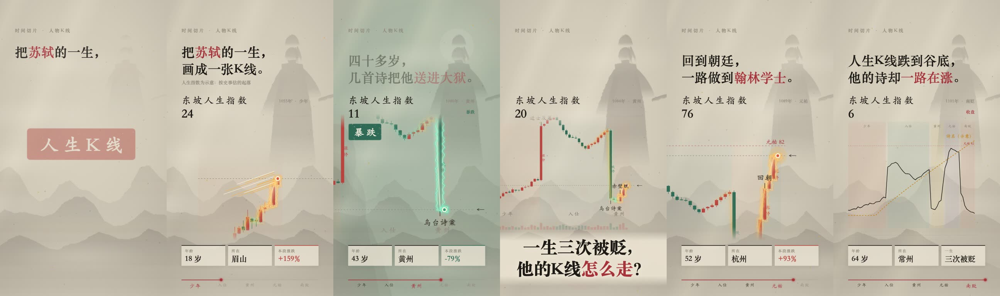

<h1 align="center">Life K-line · 人生K线</h1>

<p align="center">
  
</p>

<p align="center"><strong>把一个人的一生，画成一张K线。</strong></p>
<p align="center">一个做竖屏 9:16 短视频的 Remotion 模板：米色旧纸 + 水墨场景，K 线一根根往右长，暴涨暴跌都踩在配乐的拍子上。附带一个 Agent skill，可以给任何人物做一期新的。</p>

<p align="center">
  <a href="./LICENSE"></a>
  <a href="https://github.com/Azure12355/life-kline/stargazers"></a>
  <a href="https://github.com/Azure12355/life-kline/commits"></a>
</p>

<p align="center">
  <a href="./README.md">English</a> · <strong>简体中文</strong>
</p>

<p align="center">
  
</p>

## 目录

- [简介](#简介)
- [特点](#特点)
- [快速开始](#快速开始)
- [做你自己的一期](#做你自己的一期)
- [Agent Skill](#agent-skill)
- [项目结构](#项目结构)
- [Agent 快速上手](#agent-快速上手)
- [许可证](#许可证)

## 简介

示例视频把北宋苏轼（1037–1101）的一生画成一张股票 K 线，每年一根。1080×1920，约 41 秒，一镜到底，没有口播，只有画面、字幕、配乐和音效。

「人生指数」是按史事估算的示意值，不是真实数据，视频和封面上都标了「示意」。

全部用代码画：基于 [Remotion](https://www.remotion.dev/) 的 React + SVG。每一帧都只由帧号决定，渲染结果是确定的。

## 特点

- **一直在长的 K 线**：无框，每隔几帧长出一根；镜头跟着最新一根走，每次暴涨暴跌推到 2.3 倍特写。
- **水墨世界**：纸纹、视差远山、云雾、原创的文人水墨剪影，低谷时出现月与断崖，远贬时出现海浪，还有飘动的金屑。
- **踩拍的关键时刻**：墨爆、印章（新高 / 暴跌）、整屏红罩青罩、冲击波、闪白、大标题，全部落在拍子网格上。
- **实时信息**：指数抬头实时跳数，信息卡显示年龄、所在地、本段涨跌，配上当时写的诗和出处，底部是时期刻度带。
- **片尾总览**：整个一生收成一条线，可以加第二条线做对照（比如「诗名」）。
- **3:4 封面**：和视频用同一份数据生成。
- **音效用 ffmpeg 合成**：不带任何采样文件，没有授权问题。配乐可选，用你自己的。

## 快速开始

需要 Node.js 18+，合成音效需要 ffmpeg。

```bash
git clone https://github.com/Azure12355/life-kline.git
cd life-kline
npm install
npm run sfx        # 在 public/audio/ 里生成 5 个音效
npm run studio     # 打开 Remotion Studio，选 "LifeKline"
```

导出：

```bash
npm run render     # out/life-kline.mp4
npm run cover      # out/cover.png（1080×1440）
```

**配乐（可选）**：把你有权使用的曲子放到 `public/music/bgm.mp3`。不放也能渲染，只是只有音效。`src/timeline.ts` 的拍子网格默认按一首约 112.8 BPM、第一个大重拍在 17.45 秒的曲子写；换曲子就改 `BAR` 和 `FIRST_HIT`。详见 [`public/music/README.md`](./public/music/README.md)。

**字体**：用的是 macOS 自带的 `Songti SC`（宋体）和 `STKaiti`（楷体）。其他系统会回落到 `Noto Serif SC` 或系统衬线体。

## 做你自己的一期

只改 [`src/story.ts`](./src/story.ts)：

1. `BIRTH_YEAR`、`INDEX_NAME`、`KICKER`。
2. `SERIES`：15–20 个 `[年份, 指数 0–100]` 锚点；大事件那一年跳 30 以上。
3. `ERAS`、`EVENTS`、`PLACES`、`PEAKS`。
4. `CURSOR`：每一帧长到第几根；每次暴涨暴跌那根要正好在它的拍子上长完。
5. `NARRATION`、`TITLE`、`MOVES`、`POEMS`、`ENDING_CARD`、`COVER`。`[方括号]` 里的字是朱红色。

渲整片之前先单帧检查：

```bash
npm run typecheck
npx remotion still src/index.ts LifeKline out/check.jpg --frame=300 --scale=0.5
```

完整流程（怎么查资料、怎么把事件对到拍子上）见下面的 skill。

## Agent Skill

[`skills/life-kline-video/SKILL.md`](./skills/life-kline-video/SKILL.md) 让 AI Agent（Claude Code、Codex 等）从头做一期：选题查资料，把一生变成指数锚点，写叙述，改 `story.ts`，检查单帧，导出视频和封面。

用 [skills CLI](https://github.com/vercel-labs/skills) 安装：

```bash
npx skills add Azure12355/life-kline
```

或者把 `skills/life-kline-video/` 复制到 Agent 的 skills 目录（Claude Code 是 `.claude/skills/`）。然后说，比如：「用人生K线画一下李白的一生」。

## 项目结构

| 路径 | 用途 |
|---|---|
| `src/story.ts` | 一期的全部内容：数据、拍点、文字、封面 |
| `src/timeline.ts` | 拍子网格（`BAR`、`FIRST_HIT`）、帧率、尺寸、时长 |
| `src/LifeKline.tsx` | 视频主体 |
| `src/Cover.tsx` | 3:4 封面 |
| `src/kline/` | 可复用的风格组件：配色、舞台、图表、水墨世界、封面 |
| `src/anim.ts` | 缓动、关键帧、确定性随机 `rand` |
| `scripts/sfx.mjs` | 用 ffmpeg 合成音效 |
| `skills/life-kline-video/` | Agent skill |
| `docs/style.md` | 风格配方：配色、字体、版式、节奏 |

## Agent 快速上手

### 目标

做「人生K线」视频：把一个人（或朝代、公司、行业）的起落画成一张一直往右长的 K 线，1080×1920，约 41 秒，无口播。不做的事：真实金融数据、真实肖像、提供音乐。

### 信息来源

- 每期内容：`src/story.ts`
- 时间：`src/timeline.ts`
- 视觉规则：`docs/style.md`
- 流程：`skills/life-kline-video/SKILL.md`

### 安全流程

1. 先读 `skills/life-kline-video/SKILL.md` 和 `src/story.ts`。
2. 新一期只改 `src/story.ts`（换配乐时再改 `src/timeline.ts`）。
3. 运行 `npm run typecheck`。
4. 用 `npx remotion still ... --frame=N --scale=0.5` 单帧检查，不要为了检查渲整片。
5. 用 `npm run render` 和 `npm run cover` 导出。

### 命令

```shell
npm install
npm run sfx
npm run typecheck
npm run studio
npm run render
npm run cover
```

### 边界

- 动画必须是帧号的纯函数：不用 `Math.random()`、CSS 动画和真实时间，随机用 `src/anim.ts` 的 `rand(seed)`。
- 事实、年份、地点、引文要有可靠来源；人生指数始终标为示意。
- 不提交音乐文件（`public/music/`）、生成的音效（`public/audio/`）和成片（`out/`）。

## 许可证

代码和文档：[MIT](./LICENSE)。示例故事基于公开史料，人生指数为示意值。仓库不含任何音乐。
